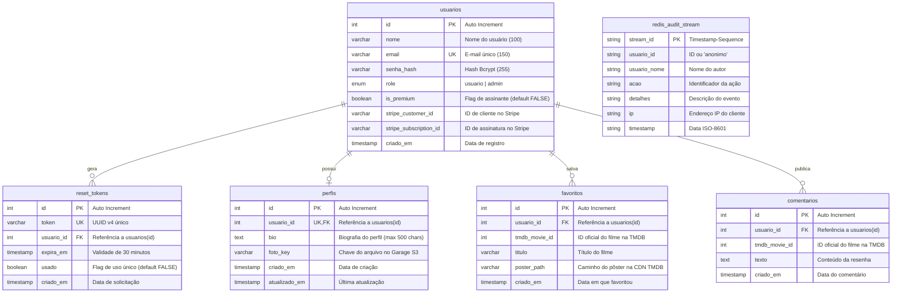

# 📖 Documentação Reversa do Sistema — Catálogo Tom Hanks

> **ISW055 · Atividade 8 · Encerramento do Projeto**  
> **Orientador:** Professor [@siriani](https://github.com/siriani)  
> **Autor:** Lucas Tetsuya Hiratuca  
> **Repositório:** [LucasHiratuca/Entrega-da-Atividade](https://github.com/LucasHiratuca/Entrega-da-Atividade)

Esta documentação foi elaborada sob a perspectiva de **engenharia reversa**: o registro detalhado, técnico e arquitetural de um sistema legado já construído ao longo dos últimos meses de desenvolvimento, mapeando suas funcionalidades, topologia de microsserviços, regras de negócio e modelo de dados.

---

## 📑 Sumário

1. [Especificação Funcional (Visão de Usuário e Negócio)](#1-especificação-funcional-visão-de-usuário-e-negócio)
2. [Arquitetura Geral do Sistema (Big Picture)](#2-arquitetura-geral-do-sistema-big-picture)
3. [Regras de Negócio Extraídas do Código ("Se X, então Y")](#3-regras-de-negócio-extraídas-do-código-se-x-então-y)
4. [Modelo de Dados e Armazenamento (DER)](#4-modelo-de-dados-e-armazenamento-der)
5. [Classificação SaaS, PaaS e IaaS](#5-classificação-saas-paas-e-iaas)

---

## 1. Especificação Funcional (Visão de Usuário e Negócio)

O sistema **Catálogo Tom Hanks** é uma plataforma web interativa voltada para entusiastas do cinema explorarem a filmografia completa do ator Tom Hanks, interagirem com a comunidade por meio de comentários, salvarem filmes em listas de favoritos, personalizarem seus perfis com fotos e realizarem upgrade para uma assinatura **Premium** com benefícios exclusivos.

### 1.1. Módulos e Funcionalidades

* **Autenticação e Gestão de Contas:**
  * **Cadastro (`/cadastro`):** Permite novos registros com nome, e-mail único e senha criptografada (mínimo de 6 caracteres).
  * **Login (`/login`):** Autenticação por e-mail e senha. Em caso de sucesso, gera um token **JWT** (JSON Web Token) válido por 24 horas contendo os papéis e permissões do usuário, que é persistido na sessão segura do navegador.
  * **Recuperação de Senha (`/esqueci-senha` e `/redefinir-senha/:token`):** Geração de link temporário com token seguro UUID enviado para o e-mail cadastrado via serviço SMTP, com tempo de expiração estrito de 30 minutos e uso único.
  * **Logout (`/logout`):** Destruição da sessão do Express e registro de evento no log de auditoria.

* **Catálogo Cinematográfico (`/filmes` e `/filme/:id`):**
  * Consumo dinâmico da API pública do **The Movie Database (TMDB)** para obter a lista consolidada de filmes (elenco e equipe) estrelados ou dirigidos por Tom Hanks, ordenados por índice de popularidade.
  * Visualização de detalhes de cada filme: cartaz em alta definição, sinopse em português, data de lançamento, avaliação média e indicação de status de favorito.

* **Sistema de Favoritos (`/favoritos`):**
  * Usuários podem favoritar e desfavoritar filmes diretamente da página de detalhes ou listagem.
  * **Diferenciação de Plano:** Usuários da conta gratuita possuem um teto rígido de **15 favoritos**. Usuários com assinatura **Premium** e **Administradores** possuem favoritos ilimitados.

* **Área Social e Comentários:**
  * Usuários logados podem publicar comentários e resenhas em cada filme.
  * **Destaque Visual:** Comentários publicados por assinantes exibem automaticamente a insígnia dourada **⭐ Premium**.
  * Usuários comuns têm permissão para excluir apenas os próprios comentários. Administradores possuem capacidade de moderação para excluir comentários de qualquer usuário.

* **Perfil e Object Storage (`/perfil/:userId` e `/perfil/:userId/editar`):**
  * Página de perfil pessoal ou pública com bio, avatar e vitrine de filmes favoritos.
  * Formulário de edição exclusivo para o dono da conta (com controle de acesso 403 para terceiros).
  * Upload de avatar validado contra mimetypes de imagem permitidos (`jpeg`, `png`, `gif`, `webp`) e limite de 5MB.
  * As imagens não ficam no banco de dados relacional: são gravadas no **Garage S3 / MinIO** e servidas através de streaming seguro pelo backend (`/perfil/:userId/foto`), blindando o storage de exposição externa.

* **Serviço de Pagamento e Assinatura Premium (`/premium`):**
  * Modelo de negócio de cobrança recorrente mensal (R$ 9,90/mês) processado em **Modo de Teste** no provedor especializado **Stripe**.
  * A aplicação gera uma `Checkout Session` oficial e redireciona o usuário para a página de pagamento hospedada pelo Stripe.
  * O processamento e confirmação ocorrem de forma assíncrona via **Webhooks assinados** (`POST /webhook/stripe`).
  * Nenhum número de cartão de crédito, CVV ou data de expiração trafega pelo backend da aplicação (conformidade com **PCI-DSS Nível 1**).

* **Painel Administrativo e Auditoria (`/admin/usuarios` e `/admin/logs`):**
  * Restrito a usuários com perfil `role: 'admin'`.
  * Visualização e listagem de todos os usuários registrados, com possibilidade de promover usuários a administradores ou rebaixá-los.
  * Painel de consulta aos eventos de auditoria armazenados em streams do **Redis**, registrando IP, data, autor e detalhes de ações sensíveis (logins, falhas de autenticação, exclusão de comentários, uploads e checkouts).

---

## 2. Arquitetura Geral do Sistema (Big Picture)

O sistema foi arquitetado em **microsserviços conteinerizados e desacoplados**, comunicando-se através de rede interna protegida no Docker (`app_network`), mantendo apenas o `catalogo-service` como ponto de entrada HTTP exposto ao cliente final.

### 2.1. Diagrama de Arquitetura (Mermaid)

```mermaid
flowchart TD
    subgraph CLIENTE["Navegador do Usuário"]
        UserBrowser["Navegador Web (Desktop / Mobile)"]
    end

    subgraph SAAS_EXTERNO["Serviços Externos (SaaS)"]
        TMDB["The Movie Database (TMDB API v3)<br><i>Metadados e Imagens de Filmes</i>"]
        StripeCheckout["Stripe Checkout & Webhooks<br><i>Processamento de Pagamento Seguro</i>"]
        MailServer["Provedor SMTP / Mailtrap<br><i>Envio de E-mails Transacionais</i>"]
    end

    subgraph IAAS_HOST["Infraestrutura (IaaS) — VM Fatec / Proxmox"]
        subgraph DOCKER_STACK["Plataforma de Containers (PaaS) — Docker & Portainer"]
            
            subgraph PUBLIC_SERVICE["Serviço Público"]
                Catalogo["catalogo-service (Porta 3000 → Host 8217)<br>• Express + EJS (SSR)<br>• Consumo TMDB API<br>• Streaming de Imagens S3<br>• Sessão Express + Flash Messages"]
            end

            subgraph INTERNAL_SERVICES["Microsserviços Internos (Isolados)"]
                Auth["auth-service (Porta 4000 interna)<br>• Emissão e Validação de JWT<br>• Criptografia Bcrypt<br>• Recuperação de Senha<br>• RBAC (Admin / Usuário)"]
                LogService["log-service (Porta 5000 interna)<br>• Ingestão de Auditoria REST<br>• Consulta de Streams"]
                RedisStream[("redis_audit (Porta 6379 interna)<br>• Redis Streams (audit:events)<br>• Retenção MAXLEN 10000")]
                GarageStorage[("garage_s3 / MinIO (Porta 3900 interna)<br>• Object Storage S3 em Rust<br>• Bucket 'perfis' (Avatares)")]
            end

        end

        subgraph DATABASE_TIER["Banco de Dados Relacional (GCP / Nuvem)"]
            MariaDB[("MariaDB (Porta 3306)<br>• Tabela usuarios<br>• Tabela reset_tokens<br>• Tabela favoritos<br>• Tabela comentarios<br>• Tabela perfis")]
        end
    end

    %% Fluxos de Comunicação
    UserBrowser -->|HTTP/HTTPS :8217| Catalogo
    Catalogo -->|REST API Interna + Bearer JWT| Auth
    Catalogo -->|REST API Interna POST /log| LogService
    Auth -->|REST API Interna POST /log| LogService
    LogService -->|XADD / XREVRANGE| RedisStream
    Catalogo -->|AWS S3 API (putObject / getObject)| GarageStorage
    
    Catalogo -->|Pool MySQL / queries| MariaDB
    Auth -->|Pool MySQL / queries| MariaDB

    Catalogo -->|HTTPS REST| TMDB
    Catalogo -->|Cria Checkout Session| StripeCheckout
    StripeCheckout -->|Webhook assíncrono POST /webhook/stripe| Catalogo
    Auth -->|SMTP TLS| MailServer
```

### 2.2. Papel de Cada Componente

| Componente | Tipo / Imagem | Porta Interna | Porta Exposta | Função Principal |
|---|---|:---:|:---:|---|
| **`catalogo-service`** | Node.js 20 (`lucashiratuca/catalogo-service`) | 3000 | **8217** | Ponto de entrada público; renderização EJS, consumo TMDB, streaming S3, sessão e rotas premium. |
| **`auth-service`** | Node.js 20 (`lucashiratuca/auth-service`) | 4000 | *Nenhuma* | Emissão e validação de tokens JWT, hashes de senha (Bcrypt), RBAC e recuperação de senhas. |
| **`log-service`** | Node.js 20 (`lucashiratuca/log-service`) | 5000 | *Nenhuma* | Barramento de auditoria assíncrona; recebe eventos de segurança e grava no Redis Streams. |
| **`redis_audit`** | Redis 7 Alpine (`redis:7-alpine`) | 6379 | *Nenhuma* | Armazenamento em memória com persistência (`appendonly`) de até 10.000 eventos de auditoria. |
| **`garage_s3`** | Garage v1.0.1 em Rust (`dxflrs/garage:v1.0.1`) | 3900 | *Nenhuma (ou 3900 p/ debug)* | Object Storage compatível com AWS S3 para persistência distribuída das fotos de perfil. |
| **`MariaDB`** | MariaDB Relacional (GCP Cloud) | 3306 | *Host Externo* | Repositório transacional de usuários, credenciais, perfis, comentários e favoritos. |

---

## 3. Regras de Negócio Extraídas do Código ("Se X, então Y")

Abaixo constam as regras de negócio reais do sistema, extraídas diretamente da implementação dos middlewares, controladores e rotas:

### 3.1. Autenticação, Cadastro e Sessão

1. **Se** a requisição for feita para uma rota protegida por `requireLogin` e não houver token/usuário válido na sessão, **então** o sistema redireciona o navegador para `/login` (ou retorna HTTP 401 se o cabeçalho `Accept` solicitar JSON).
2. **Se** na tentativa de cadastro (`POST /cadastro`) algum campo obrigatório estiver vazio ou `senha !== confirmarSenha`, **então** retorna erro e redireciona para `/cadastro`.
3. **Se** a senha informada no cadastro ou na redefinição possuir menos de 6 caracteres, **então** a requisição é rejeitada com HTTP 400 informando a exigência de tamanho mínimo.
4. **Se** o e-mail informado no cadastro já existir na tabela `usuarios`, **então** a operação é abortada retornando HTTP 409 ("Este e-mail já está cadastrado").
5. **Se** o usuário submeter credenciais incorretas no login (`POST /login`), **então** o sistema registra um evento `login_falhou` no `log-service` com o IP de origem e retorna HTTP 401 sem especificar se o erro foi no e-mail ou na senha.
6. **Se** as credenciais forem válidas, **então** é gerado um JWT assinado com algoritmo HMAC SHA-256 contendo `userId`, `nome`, `email`, `role` e `is_premium`, com expiração de 24 horas.

### 3.2. Recuperação de Senha

7. **Se** o usuário solicitar recuperação de senha para um e-mail cadastrado (`POST /forgot-password`), **então** é criado um token UUID v4 com expiração de 30 minutos na tabela `reset_tokens` e um e-mail transacional é disparado contendo o link exclusivo.
8. **Se** a solicitação de recuperação for feita para um e-mail não existente, **então** o sistema responde com a mesma mensagem de sucesso genérica (técnica de segurança contra enumeração de usuários).
9. **Se** o usuário acessar o link com um token já marcado como `usado = TRUE`, **então** o endpoint retorna HTTP 410 ("Este link já foi utilizado. Solicite um novo.").
10. **Se** a data atual for superior ao campo `expira_em` do token, **então** retorna HTTP 410 ("Este link expirou. Solicite um novo.").
11. **Se** uma nova senha for gravada com sucesso via token válido, **então** o hash Bcrypt é atualizado na tabela `usuarios` e o token é marcado como `usado = TRUE` para impedir replay attacks.

### 3.3. Controle de Acesso Baseado em Papel (RBAC) e Moderação

12. **Se** um usuário sem o papel `admin` tentar acessar rotas administrativas (`/admin/usuarios`, `/admin/logs` ou endpoints `requireAdmin`), **então** a requisição é interceptada retornando HTTP 403 Forbidden e redirecionando para `/filmes`.
13. **Se** um administrador tentar alterar o seu próprio papel em `PUT /users/:id/role`, **então** a requisição é bloqueada com HTTP 400 ("Você não pode alterar seu próprio papel") para evitar perda acidental de acesso administrativo.
14. **Se** um usuário tentar excluir um comentário (`POST /comentario/remover`) do qual **não** é o autor original e **não** possui papel `admin`, **então** o sistema bloqueia a requisição com HTTP 403 Forbidden e grava um log de violação de permissão.
15. **Se** o usuário solicitante da exclusão de comentário for `admin`, **então** a exclusão é autorizada mesmo pertencendo a outro usuário, gerando log categorizado como `moderacao_apagar_comentario`.

### 3.4. Gestão de Perfil e Uploads (Garage S3)

16. **Se** um usuário autenticado tentar acessar o formulário ou enviar alterações de perfil (`GET/POST /perfil/:userId/editar`) com ID diferente do seu próprio ID autenticado (`req.userId !== userId`), **então** o backend bloqueia a operação com HTTP 403 e renderiza a view `acesso-negado.ejs`.
17. **Se** o arquivo anexado no upload de foto exceder o limite de 5MB (`5 * 1024 * 1024 bytes`), **então** o middleware Multer interrompe o envio com código de erro de payload.
18. **Se** o mimetype do arquivo enviado não pertencer à lista permitida (`image/jpeg`, `image/png`, `image/gif`, `image/webp`), **então** o upload é cancelado com mensagem de erro.
19. **Se** o upload for válido, **então** o binário é gravado no Garage S3 com chave no formato `usuario-{userId}/{uuid}.{ext}` e o banco MariaDB recebe apenas a string correspondente no campo `perfis.foto_key`.
20. **Se** a foto de perfil for solicitada em `GET /perfil/:userId/foto`, **então** o backend recupera a stream binária diretamente do storage na rede interna e a repassa ao cliente com cabeçalho `Cache-Control: public, max-age=3600`.

### 3.5. Modelo de Negócio, Plano Premium e Stripe

21. **Se** um usuário comum gratuito tentar adicionar um novo filme aos favoritos e já tiver atingido o teto de 15 itens (`COUNT(*) >= 15`), **então** a inserção é bloqueada com aviso orientando o upgrade para o Plano Premium.
22. **Se** o usuário possuir papel `admin` **OU** tiver o status `is_premium = TRUE`, **então** a restrição de 15 favoritos é desativada, permitindo adições ilimitadas.
23. **Se** uma notificação HTTP chegar na rota `POST /webhook/stripe` e a assinatura criptográfica no cabeçalho `stripe-signature` for incompatível com o `STRIPE_WEBHOOK_SECRET`, **então** o servidor rejeita a requisição imediatamente com HTTP 400.
24. **Se** o webhook receber o evento `checkout.session.completed`, **então** o usuário correspondente é promovido no banco com `is_premium = TRUE`, seu `stripe_customer_id` e `stripe_subscription_id` são vinculados e um log de auditoria é emitido.
25. **Se** o webhook receber o evento `customer.subscription.deleted`, **então** a assinatura expirou ou foi cancelada, revertendo automaticamente o usuário para `is_premium = FALSE`.

---

## 4. Modelo de Dados e Armazenamento (DER)

A persistência do ecossistema é híbrida: dados relacionais e estruturados residem no **MariaDB**, arquivos binários de mídia residem no **Garage S3**, e logs temporais de auditoria residem no **Redis Streams**.

### 4.1. Diagrama Entidade-Relacionamento (Mermaid ERD)



### 4.2. Especificação das Tabelas

1. **`usuarios`**: Tabela central de identidades. Controla permissões administrativas via campo `role` e estado de faturamento via `is_premium`. Não armazena nenhum dado confidencial de pagamento.
2. **`perfis`**: Dados complementares de apresentação pública. A coluna `foto_key` armazena exclusivamente a URI relativa interna (ex: `usuario-1/d8b3...png`), desonerando o banco relacional de tráfego binário.
3. **`favoritos`**: Relação N:M entre usuários e filmes do TMDB. Possui restrição de unicidade composta `UNIQUE (usuario_id, tmdb_movie_id)` para impedir registros duplicados.
4. **`comentarios`**: Armazena resenhas públicas de filmes vinculadas a autores cadastrados, exibindo a tag de apoiador se `usuarios.is_premium = TRUE`.
5. **`reset_tokens`**: Tabela de uso temporário para redefinição de credenciais com expiração controlada e validação de uso único.
6. **`audit:events` (Redis Stream)**: Estrutura append-only em memória com limite fixo (`MAXLEN ~ 10000`), garantindo performance de milissegundos sem degradação do banco principal.

---

## 5. Classificação SaaS, PaaS e IaaS

A tabela a seguir sumariza a divisão de responsabilidades da infraestrutura adotada pelo projeto:

| Componente do Sistema | Camada de Nuvem | Justificativa Teórica e Técnica |
|---|:---:|---|
| **VM Proxmox / Ubuntu Server na Fatec** | **IaaS** *(Infrastructure as a Service)* | O provedor (Fatec/Proxmox) entrega apenas a virtualização de hardware (CPU, RAM, Disco e Rede). O desenvolvedor é responsável por instalar o SO, atualizar pacotes de segurança, configurar firewalls e instalar o Docker Engine. |
| **Containers da Aplicação (`catalogo-service`, `auth-service`, `log-service`)** | **PaaS** *(Platform as a Service)* | O desenvolvedor entrega exclusivamente o código-fonte empacotado em imagens Docker. O runtime do Node.js, isolamento de processos, escalabilidade e redes virtuais são gerenciados pela plataforma (Docker Engine / Portainer). |
| **Object Storage (`garage_s3`) e Cache (`redis_audit`)** | **PaaS** *(Platform as a Service)* | Serviços de armazenamento e persistência consumidos via plataforma conteinerizada pré-fabricada sem a necessidade de gerenciar sistemas operacionais dedicados para cada banco. |
| **MariaDB Gerenciado (GCP Cloud SQL)** | **PaaS** *(Platform as a Service)* | O banco relacional é consumido como plataforma de dados (`DB_HOST` em nuvem). Backups, replicação física e patching do motor MariaDB são gerenciados pelo provedor de nuvem. |
| **Stripe (Checkout & Assinaturas)** | **SaaS** *(Software as a Service)* | Solução completa e pronta de gateway de pagamento consumida via API e Webhook. Toda a interface de checkout, conformidade PCI-DSS, comunicação bancária e tokenização de cartões são geridas pelo Stripe. |
| **Mailtrap / Provedor SMTP** | **SaaS** *(Software as a Service)* | Software de entrega de e-mails transacionais consumido via protocolo de aplicação. Não há gerenciamento de servidores de e-mail (Postfix), reputação de IP, registros SPF/DKIM ou filas de envio. |
| **The Movie Database (TMDB API)** | **SaaS** *(Software as a Service)* | Serviço externo consumido via REST API que provê o catálogo de filmes, dados de bilheteria e URLs de pôsteres sem nenhuma infraestrutura mantida pelo nosso projeto. |

---

*Documentação concluída e validada para a entrega final da disciplina ISW055.*
